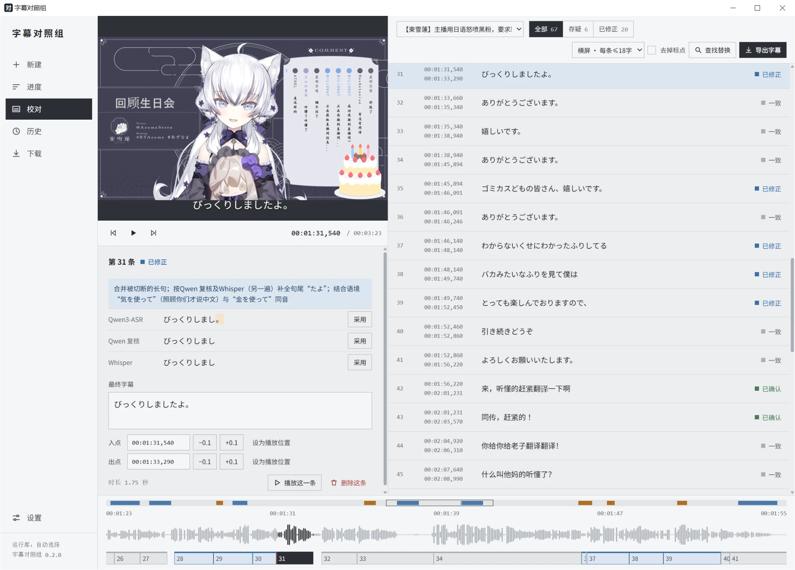
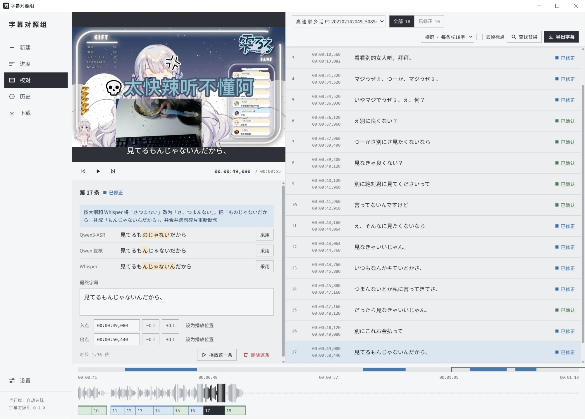
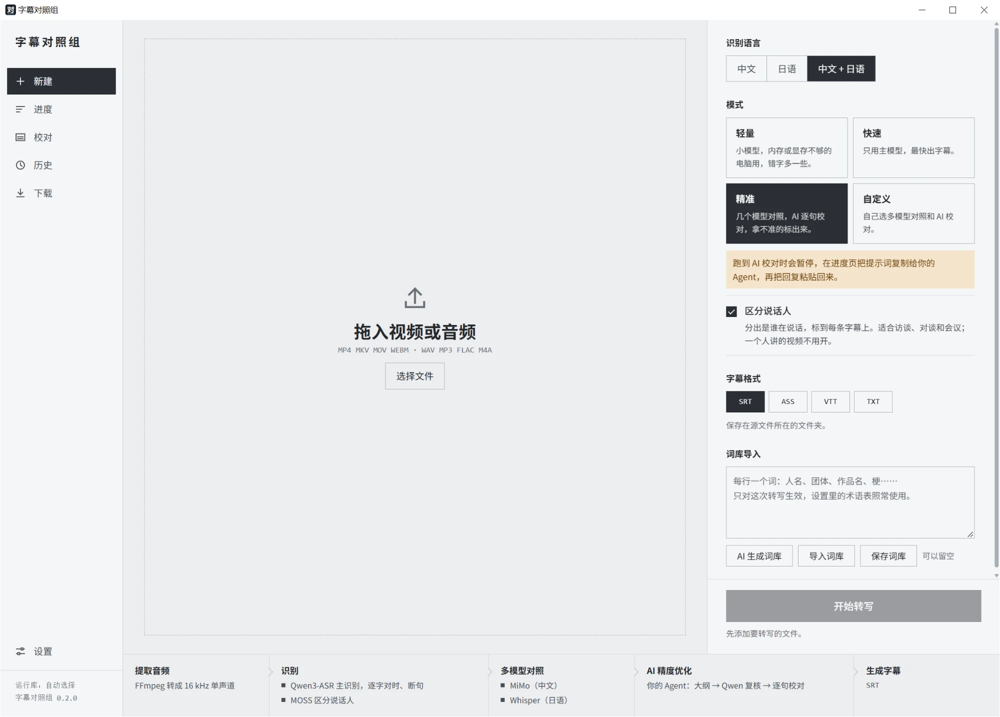

# CaptionJury

[中文](README.md) | [日本語](README.ja.md) | English

Chinese name: 字幕对照组 · Japanese name: 字幕くらべラボ

**A Chinese and Japanese subtitle tool that runs on your own computer. Several speech recognition models each transcribe the audio, the results are compared line by line, and anything uncertain is flagged — you make the final call.**

Drop in a video or audio file and export timed subtitles (SRT / ASS / VTT / TXT) that import straight into CapCut (剪映), Premiere, DaVinci Resolve and Final Cut. All speech recognition runs on your local GPU, so your audio and video never leave your computer. For extra accuracy, an AI can proofread the text by comparing the transcripts — through an API such as DeepSeek, or by copying a prompt into a chat assistant you already subscribe to (Claude, ChatGPT, etc.).

<a href="docs/images/review.webp"></a>

> This is a 0.x release for Windows only; the interface and features will change.

## Where it fits

| Use case | How |
|---|---|
| **Subtitling an edited video** (vlogs, talking-head videos, tutorials) | Drop in the finished video or its audio and pick Accurate or Fast. On export, lines are split for landscape (≤18 characters) or portrait (≤12 characters) video, and the SRT imports directly into CapCut (剪映), Premiere, DaVinci Resolve and Final Cut. |
| **Japanese videos and stream clips** | Set the language to Japanese. Comparing several models helps catch easily misheard words such as names and titles; you can import a glossary or have the AI generate one. |
| **Content with both Chinese and Japanese** (bilingual vlogs, conversations where one person speaks Chinese and the other Japanese) | Set the language to Chinese + Japanese. Speech that switches language between sentences is recognized well; see "About mixed Chinese and Japanese" below. |
| **Interviews, meetings, lectures** | Turn on speaker separation and export TXT as a transcript, or subtitles with speaker labels. |
| **Keeping recordings off the internet** | Fast mode is fully offline. AI proofreading sends only the recognized text, and you can leave it off. |
| **No powerful GPU** | Lite mode uses a small model (about 2 GB of VRAM). Without a usable GPU it still runs on the CPU, just slowly. |

### About mixed Chinese and Japanese

- **Works well**: Chinese and Japanese alternate within the same video, but each sentence is mostly in one language — like the screenshot above, where a few Chinese lines appear in the middle of a Japanese stream, or a conversation where one person speaks Chinese and the other Japanese.
- **Not yet**: Chinese and Japanese mixed inside a single sentence ("这个店の雰囲気すごく好き"). Error rates are still high for this; it is being worked on.

## How it works

1. **Local recognition**: the main model is Qwen3-ASR 1.7B. A forced-alignment model timestamps every character, and sentences are split on punctuation and pauses.
2. **Multi-model comparison** (optional): backup models such as MiMo and Whisper transcribe the audio too.
3. **AI refinement** (optional): an AI reads the full text, writes an outline and picks out proper nouns; Qwen listens again with those words as hints; finally the AI proofreads line by line, following what most of the transcripts agree on.
4. **The AI is not trusted blindly**: if an AI edit matches none of the transcripts, it is not applied silently. The line is marked "uncertain" with the reason, and you decide.
5. **Missed speech is kept**: passages the main model missed but other models heard are listed as separate uncertain lines, which you can delete if they are wrong.

Open any line to see what the AI changed and why, alongside each model's original transcript; click 采用 (Adopt) to switch to one:

<a href="docs/images/review-compare.webp"></a>

### Four modes

| Mode | What it does | Good for |
|---|---|---|
| Lite | Switches to a small model | Computers short on VRAM or memory (a few more errors) |
| Fast | Main model only, fully offline | A quick first draft, or simple content |
| **Accurate** (default) | Multi-model comparison + line-by-line AI proofreading | Subtitles you want to use as-is |
| Custom | Choose what to run | e.g. comparison without AI |

The New page estimates how long each mode will take based on your computer's past speed, and lists the steps this run will go through:

<a href="docs/images/new.webp"></a>

## Features

- **Review page**: lines are shown exactly as they will be exported, color-coded by status (agreed / confirmed / corrected / uncertain / draft), with a filter for uncertain lines. Edit text, adopt a model's version, play a line, find and replace, delete (with undo). On the timeline at the bottom, drag the left or right edge of a block to adjust in and out points against the waveform.
- **Editor-friendly lines**: long sentences are split at punctuation, pauses and word boundaries using per-character timing; punctuation can be removed. The export menu tells you where to import in each editor.
- **Glossary**: enter names and terms from this video before transcribing; import from txt or have the AI generate it.
- **Speaker separation** (optional): MOSS-Transcribe-Diarize labels each line with a speaker.
- **Automatic GPU and runtime selection**: picks a working runtime among CUDA 13 / CUDA 12.6 / Vulkan / CPU based on your GPU and driver, and falls back to the next one if it fails. A benchmark in Settings can pick the fastest. The progress page shows the device actually in use.
- **Resume**: after a cancel, an error or closing the app, "Continue" in History skips steps that already finished — and AI proofreading isn't paid for twice.
- **Download manager**: models come from Hugging Face, the hf-mirror mirror and this project's GitHub backup; runtimes from the official release or mirrors for mainland China. Sources switch automatically on failure; downloads can be paused, resumed or cancelled, and are verified with SHA-256.
- **History**: past results are kept so you can review them again, export another format, or re-transcribe with the same settings.

## Why I built it

I regularly need to subtitle videos in Chinese and Japanese, or turn recordings of classes and lab meetings into text. I tried quite a few tools, but they were either paid, or not very good at Japanese — especially content that mixes Chinese and Japanese. So eventually I decided to just build my own subtitle tool that runs locally for free.

My first idea was simple: find the most accurate speech recognition model and use it. After comparing several, I chose Qwen3-ASR as the main model. But when I tested it on a video I had proofread by hand, it got only about 78% of the characters right on its own — well short of what I'd hoped for.

Then I noticed something interesting: when I put several models' results side by side, 91% of the characters were recognized correctly by at least one of them. In other words, in many places it's not that no model can get it right — different models just make mistakes in different places. Any single model misses a lot, but if their results can be combined sensibly, there's still plenty of room to improve accuracy.

So I decided to stop relying on any one model. Instead, several models each transcribe the audio, and an AI compares their results to pick out the most reliable version. That's why the project is called CaptionJury (字幕对照组, "the subtitle comparison group").

But building it ran into another problem: the AI sometimes likes to take liberties. Even where part of the audio clearly wasn't heard, it fills in the gap from context and produces a sentence that reads smoothly but isn't what was actually said.

So I added a constraint: when the AI edits a subtitle, it must refer to the models' transcripts, and if the edited text doesn't match any of them, the line is marked uncertain for the user to confirm. That keeps the AI from improvising where it isn't sure.

I think this is one of the most important things about the tool. Rather than chasing full automation and ending up with subtitles that look fine but may contain quite a few errors, it's better to make automatic recognition as accurate as possible while clearly flagging the parts it isn't sure about. That way you don't have to check every word from start to finish — you can focus on the places most likely to be wrong, and spend as little time on manual proofreading as possible.

Also, not everyone has an API key, but many people already subscribe to Gemini, ChatGPT or Claude. So I added a mode where you simply copy the content to an AI agent — you don't have to buy a separate API service to use AI proofreading.

Of course, not everything I tried during development worked. I tried loudness normalization, even shorter audio chunks and local per-character voting, but in testing the accuracy gains were never stable. I also tried a model made specifically for Japanese, but it got nearly half the characters wrong, so in the end I removed it. More models isn't automatically better; what matters is whether the final result actually improves.

There are still plenty of unsolved problems. Switching back and forth between Chinese and Japanese within a single sentence, several people talking at once, and quiet speech are all still not recognized well enough. There's also very little hand-proofread data for evaluation so far; I need more kinds of audio to verify how well it really works, so I don't end up optimizing for just a few test samples.

Going forward, my focus remains on recognition accuracy — narrowing the gap between automatically generated subtitles and hand-proofread ones as much as possible. I also plan to gradually add translation, bilingual subtitles, English recognition and real-time captions, and if circumstances allow, a macOS version.

All in all, this is still a project that's being tested and refined, and it's some way from what I ultimately have in mind. But at least it has grown from me looking for a good subtitle tool into me solving the problems I actually ran into myself. I hope to keep improving it until it becomes a free subtitle tool that's genuinely convenient for me and for everyone else.

## Requirements

- Windows 10 / 11, 64-bit.
- A dedicated GPU is recommended: NVIDIA cards use a CUDA runtime (CUDA 13 with driver 580+, CUDA 12.6 with 528+); AMD, Intel and integrated graphics use Vulkan; without a usable GPU the CPU runtime works, but much more slowly.
- Disk: about 4 GB for the required parts; backup and speaker models are extra (MiMo 4.9 GB, Whisper and MOSS about 1.1 GB each, the Lite model 631 MB).
- Tested by the author on an RTX 3060 Laptop (12 GB VRAM); it uses about 6 GB of VRAM while running.

## Installation

1. Download `CaptionJury-Setup-<version>.exe` from [Releases](https://github.com/xy-tsuki/CaptionJury/releases) and run it. You can install for yourself only (no admin rights needed) or for all users.
2. The installer is not code-signed, so Windows may show "Unknown publisher" or SmartScreen may block it. Click "More info" → "Run anyway".
3. On first launch a setup page detects your GPU, recommends a runtime, and downloads it along with the two required models. Interrupted downloads resume.

> The app's interface is currently in Chinese only.

## Usage

1. **New**: drop in a file, pick the language (Chinese / Japanese / Chinese + Japanese) and a mode, optionally turn on speaker separation or add a glossary, choose subtitle formats and start. Subtitles are written next to the source file by default.
2. **Progress**: a progress bar per step, with estimated time remaining and the device in use. You can pause or cancel.
3. **Review**: preview and model comparison on the left, subtitle list on the right. Choose the line length, then click "Export subtitles" when done.
4. **History**: open past results, export, continue, re-transcribe, or delete records (only the app's saved results; source files and exported subtitles are untouched).
5. **Downloads**: watch model and runtime downloads and pause, resume or cancel them.

Choose how AI refinement works under Settings → Proofreading AI:

- **Provider API**: presets for DeepSeek, OpenAI, Qwen (Tongyi Qianwen), Kimi, Zhipu, SiliconFlow, OpenRouter, Gemini and Claude, or any OpenAI-compatible endpoint. API keys are encrypted with Windows DPAPI and can only be decrypted by the current Windows account.
- **Copy to agent**: for when you have no API key but subscribe to Claude, ChatGPT, Gemini, etc. Transcription pauses at this step; copy the prompt from the progress page to your assistant and paste its whole reply back.

Either way, only the recognized text is sent — never the audio or video. Fast mode is completely free; AI proofreading through an API is billed at the provider's rates.

## Where data is stored

The program is installed in `%LOCALAPPDATA%\Programs\CaptionJury` (when installed for yourself) or Program Files. Runtimes, models, settings and transcription jobs live in `%LOCALAPPDATA%\CaptionJury`, which upgrades don't touch; the uninstaller asks whether to delete it.

## Known limitations

- Windows only.
- Chinese and Japanese mixed within one sentence, overlapping speech and quiet speech are often missed or have many errors.
- The main model occasionally misses a passage; timings there are estimated from character counts, and the app warns you to check them on the review page.
- Not yet tested on real AMD or Intel GPUs or CPU-only machines.
- Recordings over an hour haven't been tested thoroughly.

## Running from source

Requires Python 3.11.

```powershell
python -m venv $env:LOCALAPPDATA\CaptionJury\venv
& "$env:LOCALAPPDATA\CaptionJury\venv\Scripts\python.exe" -m pip install -r requirements.txt
& "$env:LOCALAPPDATA\CaptionJury\venv\Scripts\python.exe" app.py
```

Build the installer with `powershell -ExecutionPolicy Bypass -File packaging\build.ps1` (requires Inno Setup 6.5+; add `-SkipInstaller` for the exe only). Developer notes are in [AGENTS.md](AGENTS.md), the change history in the [development log](docs/devlog.md), and plans in the [roadmap](docs/roadmap.md) (all in Chinese).

## License and credits

This project is released under the [GNU General Public License v3.0](LICENSE): you may use, modify and redistribute it freely, but modified versions you distribute must also be open-sourced under GPL-3.0.

- Speech recognition runtime: [CrispASR](https://github.com/CrispStrobe/CrispASR).
- Models: Qwen3-ASR, Qwen3-ForcedAligner, MiMo-V2.5-ASR, Whisper large-v3 and MOSS-Transcribe-Diarize, all under Apache-2.0 or MIT; sources are listed in [docs/model-licenses.md](docs/model-licenses.md). The models are not part of this project and are not covered by the GPL.
- The installer bundles FFmpeg (GPL); third-party licenses are installed in the `licenses` folder.
- The stream footage shown in the screenshots belongs to its respective owners and is included only to demonstrate the software.
