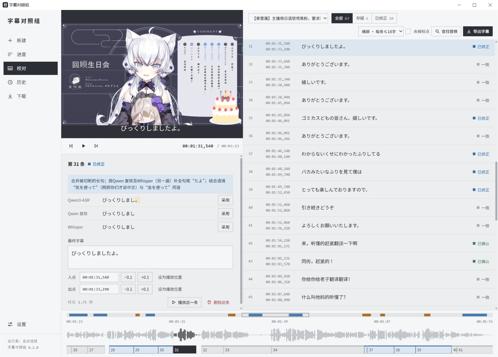
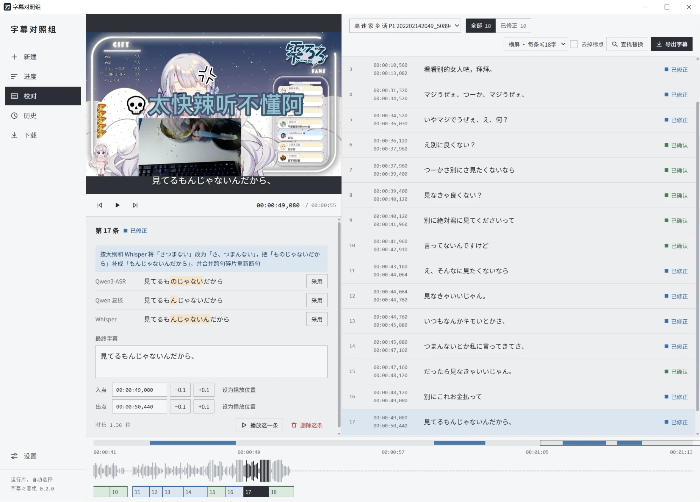
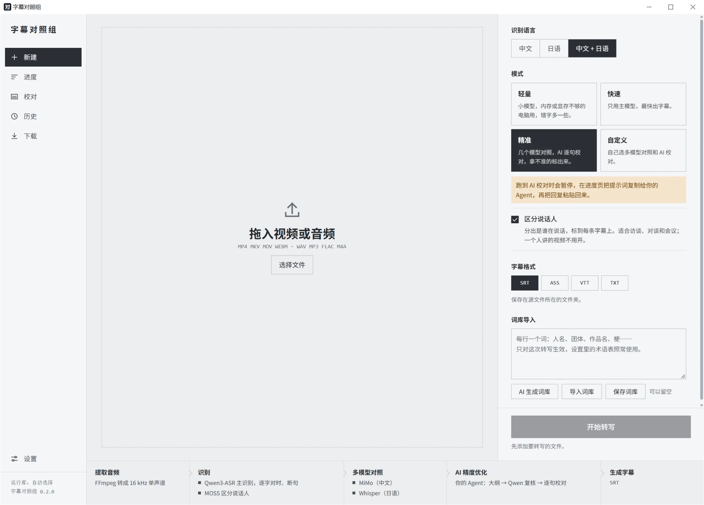

# 字幕くらべラボ · CaptionJury

[中文](README.md) | 日本語 | [English](README.en.md)

**自分の PC で動く中国語・日本語の字幕ツール。複数の音声認識モデルがそれぞれ書き起こし、一文ずつ見比べ、自信のない箇所には印を付けて、最後はあなたが決めます。**

動画や音声をドラッグするだけで、タイムコード付きの字幕（SRT / ASS / VTT / TXT）を書き出せます。CapCut（剪映）、Premiere、DaVinci Resolve、Final Cut にそのまま読み込めます。音声認識はすべてローカルの GPU で動き、音声・動画が PC の外に出ることはありません。さらに精度を上げたいときは、AI に複数の認識結果を見比べて校正させることもできます。DeepSeek などの API を使うか、契約中の Claude・ChatGPT にプロンプトをコピーして渡すかを選べます。

<a href="docs/images/review.webp"></a>

> 現在 0.x 版で、Windows 専用です。画面や機能は今後変わります。

## こんな場面で使えます

| 場面 | 使い方 |
|---|---|
| **編集した動画に字幕を付ける**（Vlog、解説、チュートリアル） | 完成した動画か音声をドラッグし、「精度重視」か「高速」を選びます。書き出し時に横長（1 行 18 字以内）・縦長（12 字以内）に合わせて分割され、SRT は CapCut（剪映）、Premiere、DaVinci Resolve、Final Cut にそのまま読み込めます。 |
| **日本語の動画・配信の切り抜き** | 認識言語を「日本語」にします。複数モデルの比較で、人名や作品名など聞き間違えやすい語を見つけやすくなります。用語集を読み込んだり、AI に作らせたりもできます。 |
| **中国語と日本語が両方出てくる内容**（日中バイリンガル Vlog、片方が中国語・片方が日本語で話す対談など） | 認識言語を「中国語 + 日本語」にします。一文ごとに言語が切り替わる話し方ならよく認識できます。詳しくは下の「日中混在について」を参照してください。 |
| **インタビュー・会議・講義の録音** | 「話者を区別」にチェックを入れ、TXT で書き起こしとして、または話者付きの字幕として書き出します。 |
| **録音をネットに上げたくない** | 高速モードは完全オフライン。AI 校正で送るのは認識したテキストだけで、使わない選択もできます。 |
| **高性能な GPU がない** | 「軽量」モードは小さいモデル（VRAM 約 2 GB）を使います。使える GPU がなくても CPU で動きます（遅くなります）。 |

### 日中混在について

- **得意なこと**：同じ動画の中で中国語と日本語が交互に出てくるが、一文はほぼ一つの言語で話している場合。たとえば上のスクリーンショットのように日本語の配信の途中に中国語が数文入る場合や、対談で一人が中国語、もう一人が日本語で話す場合です。
- **まだ苦手なこと**：一文の中で中国語と日本語が混ざる話し方（「这个店の雰囲気すごく好き」など）。現時点では誤りがまだ多く、改善を続けています。

## しくみ

1. **ローカル認識**：メインモデルは Qwen3-ASR 1.7B。強制アライメントモデルで一文字ずつ時刻を付け、句読点と間（ま）で文を区切ります。
2. **複数モデルの比較**（任意）：MiMo、Whisper などの予備モデルでも書き起こします。
3. **AI による精度向上**（任意）：AI が全文を読んで概要を書き、固有名詞を拾います。Qwen はその語をヒントにもう一度聞き直し、最後に AI が「複数の結果のうち多数が一致する表記」に基づいて一文ずつ校正します。
4. **AI をうのみにしない**：AI の修正がどの認識結果とも合わない場合は採用せず、「要確認」として理由を添え、判断をあなたに委ねます。
5. **聞き漏らしも捨てない**：メインモデルが聞き逃し、他のモデルが拾った部分は、要確認の字幕として別に並べます。不要なら削除できます。

どの行を開いても、AI が何をなぜ直したか、各モデルの元の表記がどうだったかが分かり、「采用」（採用）ボタンで切り替えられます。

<a href="docs/images/review-compare.webp"></a>

### 4 つのモード

| モード | 内容 | 向いている用途 |
|---|---|---|
| 軽量 | 小さいモデルに切り替え | VRAM やメモリが少ない PC（誤りはやや増える） |
| 高速 | メインモデルだけ、完全オフライン | まず一度見てみたいとき、内容が簡単なとき |
| **精度重視**（既定） | 複数モデルの比較 + AI による一文ずつの校正 | そのまま使える字幕がほしいとき |
| カスタム | 使う機能を自分で選ぶ | 比較だけ使い、AI は使わない、など |

新規作成画面では、その PC での過去の速度から所要時間を見積もり、今回実行する手順を下に表示します。

<a href="docs/images/new.webp"></a>

## 機能

- **校正画面**：書き出すときと同じ単位で一行ずつ並び、状態（一致 / 確認済み / 修正済み / 要確認 / 下書き）を色で示します。要確認だけの表示もできます。文字の修正、各モデルの表記の採用、その行の再生、検索と置換、削除（元に戻せます）。下部のタイムラインでブロックの左右の端をドラッグすれば、波形を見ながらイン点・アウト点を調整できます。
- **編集向けの字幕分割**：一文字ずつの時刻を使い、句読点・間・語の切れ目で長い文を分けます。句読点を取り除くこともできます。書き出しメニューに各編集ソフトでの読み込み場所を書いてあります。
- **用語集**：その動画に出てくる人名・用語を事前に入力できます。txt の読み込みや AI による生成にも対応。
- **話者の区別**（任意）：MOSS-Transcribe-Diarize で字幕ごとに話者を付けます。
- **GPU とランタイムの自動選択**：GPU とドライバーに応じて CUDA 13 / CUDA 12.6 / Vulkan / CPU から使えるものを選び、失敗したら次に切り替えます。設定画面で実測していちばん速いものを選ぶこともできます。進捗画面に実際のデバイスが表示されます。
- **途中から再開**：キャンセル、エラー、アプリを閉じた場合も、履歴の「続きから」で再開でき、終わった手順はやり直しません。AI 校正の料金も二重にかかりません。
- **ダウンロード管理**：モデルは Hugging Face、hf-mirror、本プロジェクトの GitHub バックアップの 3 か所から、ランタイムは公式と中国本土向けミラーから取得し、失敗すると自動で切り替えます。一時停止・再開・キャンセルができ、完了後に SHA-256 を検証します。
- **履歴**：過去の結果を残しておき、校正し直す、別の形式で書き出す、当時の設定で書き起こし直す、ができます。

## 開発の経緯

普段から、中国語や日本語の動画に字幕を付けたり、授業やゼミの録音を文字に起こしたりすることがよくあります。これまで関連ツールをいろいろ試してきましたが、有料だったり、日本語、とくに日中が混ざった内容の認識があまり良くなかったりしました。それなら、ローカルで無料で動く字幕ツールを自分で作ってしまおう、と考えるようになりました。

最初の発想はとてもシンプルで、いちばん精度の高い音声認識モデルを見つけて使う、というものでした。一通り比較した結果、メインモデルには Qwen3-ASR を選びました。ところが人手で校正した動画で実際に試してみると、単独での文字正解率は約 78% しかなく、期待していた水準とはかなり差がありました。

その後、面白いことに気づきました。複数のモデルの認識結果を並べて比べると、少なくとも一つのモデルが正しく認識できている文字は 91% に達するのです。つまり、多くの箇所はどのモデルも認識できないわけではなく、モデルごとに間違える場所が違うということです。どれか一つのモデルだけでは多くを取りこぼしますが、それぞれの結果をうまく組み合わせれば、精度にはまだ大きな伸びしろがあります。

そこで、一つのモデルだけに頼るのはやめて、複数のモデルにそれぞれ認識させ、AI にそれらの結果を見比べさせて、できるだけ信頼できる内容を選ぶことにしました。これが、プロジェクトを「字幕くらべラボ（字幕对照组）」と名付けた理由です。

ただ、実際に作ってみると別の問題にぶつかりました。AI がときどき勝手な判断をしすぎるのです。音声の中で聞き取れていない箇所があっても、文脈から補ってしまい、いかにも自然だけれど実際には言っていない文を作ってしまいます。

そこで、もう一つ制約を加えました。AI が字幕を修正するときは各モデルの認識結果を参照しなければならず、修正後の内容がどのモデルの結果とも一致しない場合は「要確認」として印を付け、ユーザーに判断してもらいます。不確かな箇所で AI が好き勝手に書き換えるのを防ぐためです。

これはこのツールのかなり大事な点だと思っています。完全自動化だけを追い求めて、一見問題なさそうでも実は誤りの多い字幕を作るより、自動認識の精度をできるだけ上げつつ、自信のない箇所ははっきり示すほうがいい。そうすればユーザーは最初から最後まで一字ずつ確認する必要がなく、間違っていそうな箇所に集中できるので、人手による校正の手間をできるだけ減らせます。

また、誰もが API キーを持っているわけではなくても、Gemini、ChatGPT、Claude などを契約している人は多いと考え、内容をそのまま AI Agent にコピーして処理してもらうモードも加えました。わざわざ API サービスを別途購入しなくても、AI 校正を使えます。

もちろん、開発中に試したことがすべて役に立ったわけではありません。音量の正規化、音声の区切りをさらに短くする、ローカルで一文字ずつ多数決を取る、といった方法も試しましたが、実際に測ってみると精度の向上は安定しませんでした。日本語専用の認識モデルも試しましたが、半分近くの文字が間違っていたので、最終的に外しました。モデルは多ければいいわけではなく、大事なのは最終的な認識結果が本当に良くなるかどうかです。

今のところ、このプロジェクトにはまだ解決できていない問題がたくさんあります。たとえば一文の中で中国語と日本語が行き来する場合、複数人が同時に話す場合、声が小さい場合などは、認識結果がまだ十分ではありません。また、評価に使う人手校正のデータもまだ少なく、少数のテストサンプルだけに合わせた最適化にならないよう、さまざまな種類の音声で実際の効果を確かめる必要があります。

今後も重点は認識精度に置き、自動生成した字幕と人手で校正した結果との差をできるだけ縮めていくつもりです。あわせて、翻訳、二言語字幕、英語の認識、リアルタイム字幕などの機能も少しずつ加えていく予定で、条件が整えば macOS 版も作りたいと考えています。

まとめると、これはまだテストと改良を続けている途中のプロジェクトで、理想とする姿まではまだ距離があります。それでも、最初は使いやすい字幕ツールを探していただけだったのが、少しずつ、実際に直面した問題を自分の手で解決するものに変わってきました。これからも改良を続け、最終的には自分にもほかの人にも本当に使いやすい無料の字幕ツールにしたいと思っています。

## 動作環境

- Windows 10 / 11（64 ビット）。
- 独立 GPU を推奨：NVIDIA は CUDA 版ランタイム（ドライバー 580 以上は CUDA 13、528 以上は CUDA 12.6）、AMD・Intel・内蔵 GPU は Vulkan 版。使える GPU がない場合は CPU 版（かなり遅くなります）。
- ストレージ：必須分で約 4 GB。予備モデル・話者モデルは別（MiMo 4.9 GB、Whisper と MOSS は各約 1.1 GB、軽量モード用の小モデル 631 MB）。
- 作者は RTX 3060 Laptop（VRAM 12 GB）で動作確認しています。実行時の VRAM 使用量は約 6 GB です。

## インストール

1. [Releases](https://github.com/xy-tsuki/CaptionJury/releases) から `CaptionJury-Setup-<バージョン>.exe` をダウンロードして実行します。自分だけ（管理者権限不要）か、すべてのユーザー向けにインストールできます。
2. インストーラーにはコード署名がないため、「不明な発行元」と表示されたり SmartScreen に止められたりすることがあります。「詳細情報」→「実行」を押してください。
3. 初回起動時はセットアップ画面になり、GPU を調べてランタイムを提案し、ランタイムと必須モデル 2 つをダウンロードします。中断しても続きから再開できます。

> アプリの画面は現在、中国語のみです。

## 使い方

1. **新規作成**：ファイルをドラッグし、認識言語（中国語 / 日本語 / 中国語 + 日本語）とモードを選び、必要なら話者の区別や用語集を設定して、字幕形式を選んで開始します。字幕は既定で元ファイルと同じフォルダーに書き出されます。
2. **進捗**：手順ごとに進捗バー、残り時間の見込み、実際に使っているデバイスを表示します。一時停止・キャンセルができます。
3. **校正**：左にプレビューと各モデルの表記の比較、右に字幕リスト。1 行の字数を選び、終わったら「字幕を書き出す」。
4. **履歴**：過去の結果を開く、書き出す、続きから再開、書き起こし直す、記録を削除する（アプリ内の結果だけを消し、元ファイルや書き出した字幕には触れません）。
5. **ダウンロード**：モデルとランタイムの進捗を確認し、一時停止・再開・キャンセルできます。

AI による精度向上は「設定 → 校正 AI」で方式を選びます。

- **サービスの API**：DeepSeek、OpenAI、Qwen（通義千問）、Kimi、Zhipu（智譜）、SiliconFlow、OpenRouter、Gemini、Claude を用意しているほか、OpenAI 互換の任意のアドレスも使えます。API キーは Windows DPAPI で暗号化して保存し、現在の Windows アカウントでしか復号できません。
- **Agent にコピー**：API キーはないが Claude、ChatGPT、Gemini などを契約している場合に。この手順で処理が一時停止するので、進捗画面のプロンプトを Agent に渡し、返答をまるごと貼り付けます。

どちらの方式でも送るのは認識したテキストだけで、音声・動画はアップロードしません。高速モードは完全に無料です。API で AI 校正をする場合は、各サービスの料金がかかります。

## データの保存場所

プログラムは `%LOCALAPPDATA%\Programs\CaptionJury`（自分だけにインストールした場合）または Program Files に入ります。ランタイム、モデル、設定、書き起こしデータは `%LOCALAPPDATA%\CaptionJury` にあり、アップデートしても消えません。アンインストール時に一緒に削除するか確認します。

## 既知の制限

- Windows のみ対応。
- 一文の中での日中混在、複数人の同時発話、小声は、認識できなかったり誤りが多かったりします。
- メインモデルがたまに一部を聞き漏らします。その部分の字幕の時刻は文字数から推定したもので、アプリが知らせるので校正画面で確認してください。
- AMD・Intel の GPU や CPU だけの PC では、まだ実機で試していません。
- 1 時間を超える長い録音はまだ十分に試していません。

## ソースから実行

Python 3.11 が必要です。

```powershell
python -m venv $env:LOCALAPPDATA\CaptionJury\venv
& "$env:LOCALAPPDATA\CaptionJury\venv\Scripts\python.exe" -m pip install -r requirements.txt
& "$env:LOCALAPPDATA\CaptionJury\venv\Scripts\python.exe" app.py
```

インストーラーのビルド：`powershell -ExecutionPolicy Bypass -File packaging\build.ps1`（Inno Setup 6.5 以上が必要。`-SkipInstaller` を付けると exe だけを出力）。開発者向けの説明は [AGENTS.md](AGENTS.md)、変更履歴は [開発ログ](docs/devlog.md)、計画は [ロードマップ](docs/roadmap.md) にあります（いずれも中国語）。

## ライセンスと謝辞

本プロジェクトは [GNU General Public License v3.0](LICENSE) で公開しています。自由に使用・改変・再配布できますが、改変版を配布する場合は GPL-3.0 でソースコードを公開する必要があります。

- 音声認識ランタイム：[CrispASR](https://github.com/CrispStrobe/CrispASR)。
- モデル：Qwen3-ASR、Qwen3-ForcedAligner、MiMo-V2.5-ASR、Whisper large-v3、MOSS-Transcribe-Diarize。いずれも Apache-2.0 または MIT ライセンスで、入手元は [docs/model-licenses.md](docs/model-licenses.md) を参照してください。モデルは本プロジェクトの一部ではなく、GPL の対象ではありません。
- インストーラーには FFmpeg（GPL）を同梱しています。サードパーティのライセンスはインストール先の `licenses` フォルダーにあります。
- スクリーンショットに写っている配信映像の著作権は各権利者に帰属し、ソフトウェアの動作例として掲載しています。
