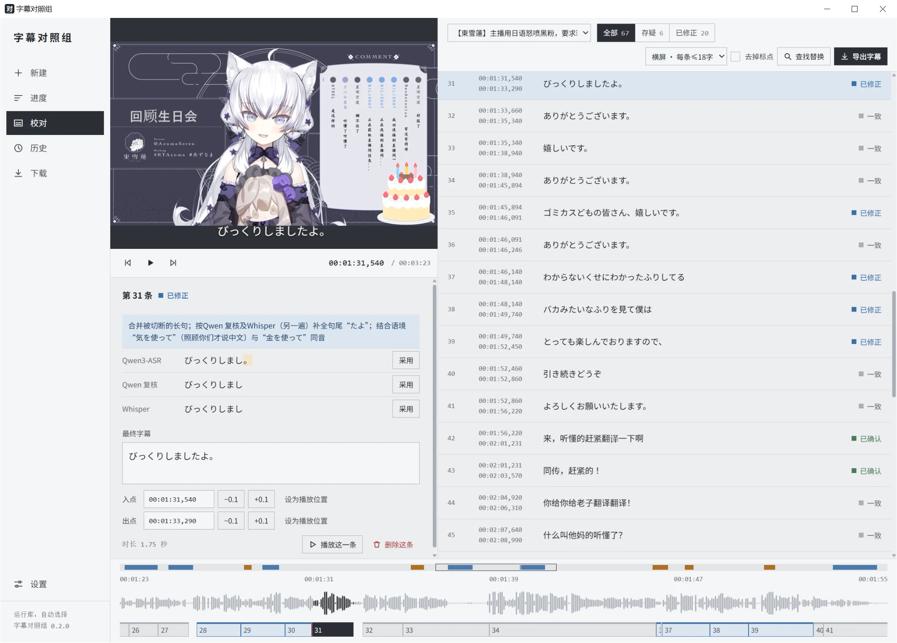
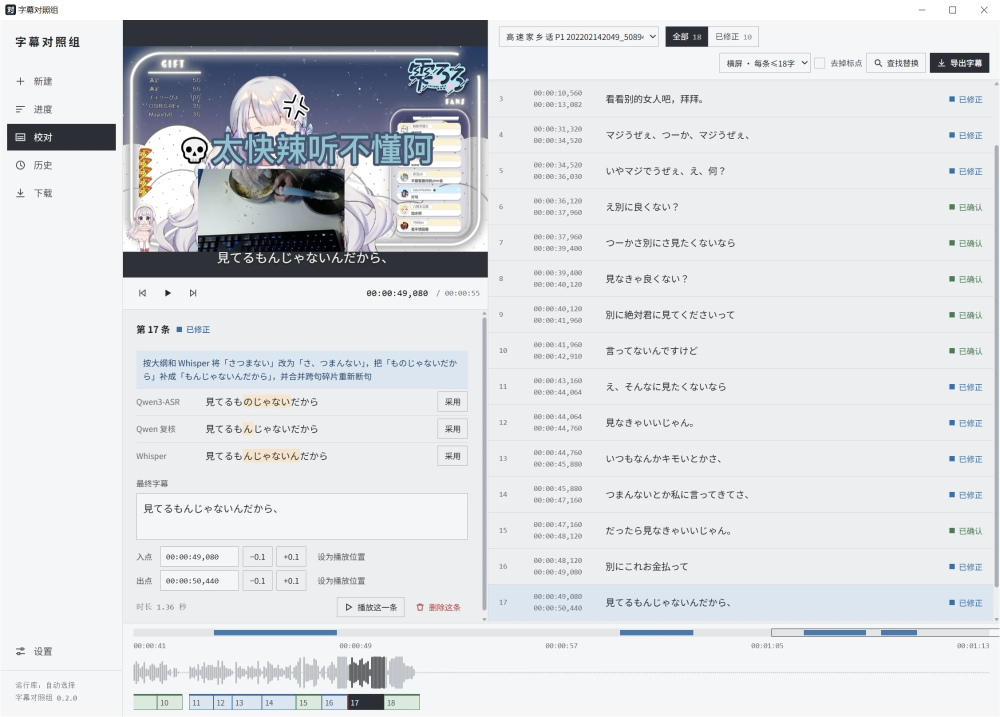
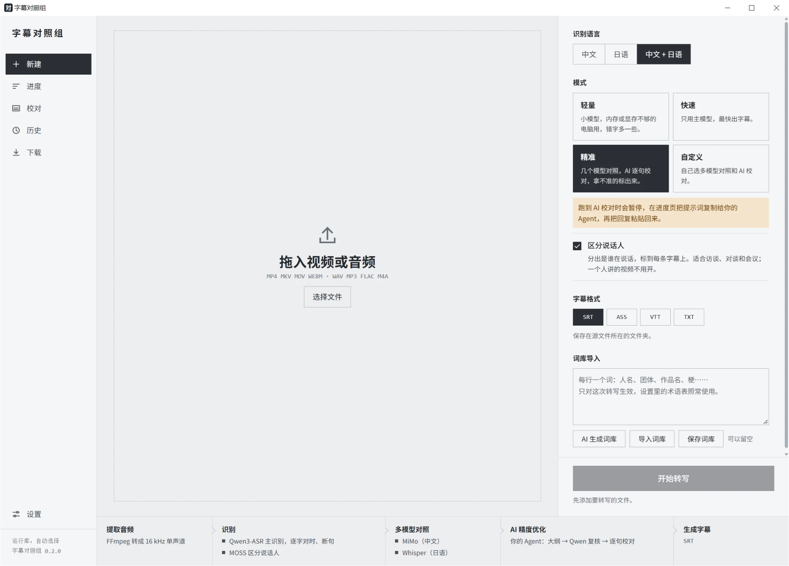

# 字幕对照组 · CaptionJury

中文 | [日本語](README.ja.md) | [English](README.en.md)

**在自己电脑上跑的中文、日语字幕工具。几个识别模型各听一遍，逐句对照，拿不准的地方标出来，由你来定。**

拖进视频或音频，导出带时间轴的字幕（SRT / ASS / VTT / TXT），可以直接导入剪映、Premiere、达芬奇、Final Cut。语音识别全部在本机显卡上跑，音视频不出电脑。想要更准，可以再让 AI 对照几份识别结果校对文字：用 DeepSeek 等服务商的 API，或者把提示词复制给你已经订阅的 Claude、ChatGPT。

<a href="docs/images/review.webp"></a>

> 目前是 0.x 版本，只支持 Windows，界面和功能还会变。

## 适合哪些场景

| 场景 | 怎么用 |
|---|---|
| **剪完视频打字幕**（vlog、口播、教程） | 拖入成片，选「精准」或「快速」。导出时按横屏（每条 ≤18 字）或竖屏（≤12 字）拆好，SRT 直接拖进剪辑软件。 |
| **日语视频、直播切片** | 识别语言选「日语」。几个模型的写法放在一起，人名、作品名这类容易听错的词一眼就能看出来；可以先导入词库，或者让 AI 生成一份。 |
| **中日双语内容**（双语 vlog、日语直播配中文讲解、一个说中文一个说日语的对谈） | 识别语言选「中文 + 日语」。按句切换语言的说法认得比较好，见下面的「关于中日混说」。 |
| **采访、会议、课程录音** | 勾「区分说话人」，导出 TXT 当文字稿，或者导出带说话人的字幕。 |
| **不想把录音传到网上** | 快速模式全程离线；AI 校对只发送识别出的文字，也可以不开。 |
| **电脑没有好显卡** | 「轻量」模式换小模型（约 2 GB 显存）；没有可用显卡时也能用 CPU 跑，只是慢。 |

### 关于中日混说

- **认得好**：同一段视频里中文和日语交替出现，但每句话基本只用一种语言。比如上面截图里，日语直播中间插了几句中文；又比如对谈里一个人说中文、一个人说日语。
- **还不行**：一句话里中文和日语夹在一起说（「这个店の雰囲気すごく好き」）。这种情况现在错字还比较多，会继续改进。

## 它是怎么工作的

1. **本机识别**：主模型 Qwen3-ASR 1.7B 先听一遍，强制对齐模型给每个字标上时间，再按标点和停顿断句。
2. **多模型对照**（可选）：MiMo、Whisper 等备用模型再各听一遍。
3. **AI 精度优化**（可选）：AI 先通读全文写大纲、找出人名和术语，Qwen 带着这些词再听一遍；最后 AI 逐句校对，以「几份结果里多数一致的写法」为准。
4. **不盲信 AI**：AI 的修改在任何一份识别结果里都找不到依据时，不直接采用，而是标成「存疑」并写明原因，留给你决定。
5. **漏掉的话不丢**：主模型没听到、其他模型听到的段落，单独列成存疑字幕，用不上可以删。

点开任何一条，都能看到 AI 改了什么、为什么改，以及每个模型的原始写法，点「采用」就能换：

<a href="docs/images/review-compare.webp"></a>

### 四种模式

| 模式 | 做什么 | 适合 |
|---|---|---|
| 轻量 | 换成小模型 | 显存或内存不够的电脑，错字会多一些 |
| 快速 | 只用主模型，完全离线 | 先出一版看看，或者内容简单 |
| **精准**（默认） | 多模型对照 + AI 逐句校对 | 要直接拿去用的字幕 |
| 自定义 | 自己选开哪些 | 比如只要对照、不要 AI |

新建页会按你电脑以往的速度估算各要多久，并在底部列出这次会跑哪些步骤：

<a href="docs/images/new.webp"></a>

## 功能一览

- **校对页**：按导出的样子一条条列出，颜色标出状态（一致 / 已确认 / 已修正 / 存疑 / 初稿），可以只看存疑的。改文字、采用某个模型的写法、播放这一条、查找替换、删除（可撤销）；在底部时间条上拖动方块的左右边缘，对着波形改入点出点。
- **适合剪辑的字幕条**：按每个字的时间，在标点、停顿和词的分界处拆开长句；可以去掉标点。导出菜单里写了各剪辑软件从哪里导入。
- **任务词库**：转写前填入这次视频里的人名、团体名、作品名，可以导入 txt，也可以让 AI 生成。
- **区分说话人**（可选）：用 MOSS-Transcribe-Diarize 给每条字幕标上说话人。
- **自动选显卡和运行库**：按显卡和驱动在 CUDA 13 / CUDA 12.6 / Vulkan / CPU 中挑能用的那个，用不了自动换下一个；设置里可以实测哪个最快。进度页显示实际用的设备。
- **断点续跑**：中途取消、出错或关掉程序，在历史里「继续转写」，跑完的步骤不重跑，AI 校对也不用再花一次钱。
- **下载管理**：模型有 Hugging Face、hf-mirror 镜像、本项目 GitHub 备份三个来源，运行库有官方和国内加速镜像，失败自动换源；可以暂停、继续、取消，下完校验 SHA-256。
- **历史记录**：以前的结果都留着，可以重新打开校对、换格式导出，或者用当时的设置重新转写。

## 开发的心路历程

我平时经常需要给中文、日语的视频做字幕，或者把上课、组会的录音转成文字。之前找过不少相关工具，但要么需要付费，要么对日语，尤其是中日混合内容的识别效果不太理想。所以后来就想着，干脆自己做一个能在本地免费运行的字幕工具。

最开始的想法其实很简单，就是找一个准确率最高的语音识别模型来用。对比了一圈之后，最后选了 Qwen3-ASR 作为主模型。不过拿人工校对过的视频实际测试了一下，发现它单独的字准确率只有大约 78%，离我预期的效果还有不小的差距。

但后来发现了一个挺有意思的现象：如果把几个模型的识别结果放在一起对比，至少有一个模型识别正确的字能达到 91%。也就是说，很多地方并不是模型都识别不出来，而是不同模型会在不同的地方出错。单独用任何一个模型都会漏掉不少内容，但如果能把它们的结果合理地结合起来，准确率就还有不小的提升空间。

所以我就决定不再只依赖某一个模型，而是让多个模型分别识别，再通过 AI 对照它们的结果，尽量选出最可靠的内容。这也是后来把项目叫作「字幕对照组」的原因。

不过实际做下来又遇到了一个问题，就是 AI 有时候太喜欢自作主张了。明明音频里有些地方没听清楚，它也会根据上下文自行补全，生成一句看起来很通顺、但实际上并不是原话的内容。

所以后来又加了一条限制：AI 修改字幕时必须参考各个模型的识别结果，如果修改后的内容和所有模型的结果都不一致，就标记为存疑，交给用户自己确认，避免 AI 在不确定的地方随意发挥。

我觉得这也是这个工具比较重要的一点。与其一味追求完全自动化，最后生成一份看起来没什么问题、实际上可能有不少错误的字幕，不如尽可能提高自动识别的准确率，同时把拿不准的地方明确标出来。这样用户就不需要从头到尾逐字检查，而是可以把精力集中在那些可能出错的地方，尽量减少人工校对的工作量。

另外，考虑到不是所有人都有 API 密钥，但可能已经订阅了 Gemini、ChatGPT 或 Claude，所以还加入了一个可以直接复制内容给 AI Agent 处理的模式，不一定非要额外购买 API 服务才能使用 AI 校对功能。

当然，开发过程中也不是所有尝试都有用。中间试过响度标准化、进一步缩短音频切块、本地逐字投票等方案，但实际测试下来，准确率的提升都不太稳定。还试过一个专门识别日语的模型，结果将近一半的字都是错的，最后还是决定去掉。毕竟模型也不是越多越好，关键还是能不能真正提高最终的识别效果。

目前这个项目其实还有不少问题没有解决。比如一句话里中文和日语来回切换、多人同时说话、声音比较小等情况，识别效果都还不够理想。另外，目前用于评测的人工校对数据也比较少，还需要更多不同类型的音频来验证实际效果，避免只针对少数测试样本优化。

后续还是打算继续把重点放在识别精度上，尽可能缩小自动生成字幕和人工校对结果之间的差距。同时也计划逐步加入翻译、双语字幕、英语识别、实时字幕等功能，如果条件允许的话，还会做一个 macOS 版本。

总之，目前还只是一个在不断测试和完善中的项目，离我理想中的效果还有一定距离。不过至少已经从最开始想找一个好用的字幕工具，慢慢变成了自己动手解决实际遇到的问题。希望后续能继续完善，最后做成一个真正方便自己和其他人使用的免费字幕工具。

## 系统要求

- Windows 10 / 11，64 位。
- 建议有独立显卡：NVIDIA 显卡用 CUDA 版运行库（驱动 580 以上用 CUDA 13，528 以上用 CUDA 12.6）；AMD、Intel 显卡和核显用 Vulkan 版；没有可用显卡时用 CPU 版，但慢很多。
- 硬盘：必装部分约 4 GB；备用模型和说话人模型另算（MiMo 4.9 GB，Whisper、MOSS 各约 1.1 GB，轻量模式的小模型 631 MB）。
- 作者在 RTX 3060 Laptop（12 GB 显存）上测试，运行时占用约 6 GB 显存。

## 安装

1. 在 [Releases](https://github.com/xy-tsuki/CaptionJury/releases) 下载 `CaptionJury-Setup-<版本>.exe`，双击安装。可以只为自己安装（不需要管理员权限），也可以为所有用户安装。
2. 安装包没有代码签名，Windows 可能提示「未知发布者」或被 SmartScreen（Windows 的下载安全检查）拦下，点「更多信息」→「仍要运行」。
3. 第一次打开会进入引导页：程序检测显卡、推荐运行库，然后下载运行库和两个必装模型。中断后可以续传。

## 使用

1. **新建**：拖入文件，选识别语言（中文 / 日语 / 中文 + 日语）和模式；需要时勾「区分说话人」、填词库；选字幕格式，开始转写。字幕默认存在源文件旁边。
2. **进度**：每一步一条进度条，显示预计剩余时间和实际用的设备，可以暂停或取消。
3. **校对**：左边是预览和各模型写法的对照，右边是字幕列表。选好每条字数，改完点「导出字幕」。
4. **历史**：打开以前的结果、导出、继续转写、重新转写，或者删除记录（只删程序里保存的结果，不动源文件和导出的字幕）。
5. **下载**：查看模型和运行库的下载进度，暂停、继续或取消。

AI 精度优化在「设置 → 校对 AI」里选一种方式：

- **服务商接口**：预置 DeepSeek、OpenAI、通义千问、Kimi、智谱、硅基流动、OpenRouter、Gemini、Claude，也可以填自定义的 OpenAI 兼容地址。API 密钥用 Windows DPAPI 加密保存，只有当前 Windows 账户能解开。
- **复制给 Agent**：没有 API 密钥、但订阅了 Claude、ChatGPT、Gemini 等时用。转写跑到这一步会暂停，把进度页的提示词复制给 Agent，再把回复整段粘贴回来。

两种方式都只发送识别出的文字，不上传音视频。快速模式完全免费；AI 校对走接口时按服务商的价格计费。

## 数据放在哪里

程序装在 `%LOCALAPPDATA%\Programs\CaptionJury`（只为自己安装时）或 Program Files。运行库、模型、设置和转写任务都在 `%LOCALAPPDATA%\CaptionJury`，升级不会动它们；卸载时会问要不要一起删掉。

## 已知限制

- 只支持 Windows。
- 一句话里中日夹杂、几个人同时说话、小声说话，常识别不出来或错字较多。
- 主模型偶尔漏听一段，那里的字幕时间是按字数估算的，程序会提示，需要在校对页对一下。
- AMD、Intel 显卡和纯 CPU 的电脑还没有实机测过。
- 1 小时以上的长录音还没有充分测试。

## 从源码运行

需要 Python 3.11。

```powershell
python -m venv $env:LOCALAPPDATA\CaptionJury\venv
& "$env:LOCALAPPDATA\CaptionJury\venv\Scripts\python.exe" -m pip install -r requirements.txt
& "$env:LOCALAPPDATA\CaptionJury\venv\Scripts\python.exe" app.py
```

构建安装包：`powershell -ExecutionPolicy Bypass -File packaging\build.ps1`（需要 Inno Setup 6.5 以上；加 `-SkipInstaller` 只出 exe）。开发说明见 [AGENTS.md](AGENTS.md)，改动记录见 [开发日志](docs/devlog.md)，计划见 [路线图](docs/roadmap.md)。

## 许可证与致谢

本项目以 [GNU General Public License v3.0](LICENSE) 发布：可以自由使用、修改和分发，但分发修改后的版本时也要以 GPL-3.0 公开源代码。

- 语音识别运行库：[CrispASR](https://github.com/CrispStrobe/CrispASR)。
- 模型：Qwen3-ASR、Qwen3-ForcedAligner、MiMo-V2.5-ASR、Whisper large-v3、MOSS-Transcribe-Diarize，均为 Apache-2.0 或 MIT 许可，来源见 [docs/model-licenses.md](docs/model-licenses.md)。模型不属于本项目，不受 GPL 约束。
- 安装包自带 FFmpeg（GPL），第三方许可证随安装包放在 `licenses` 目录。
- 截图里的直播画面版权归原作者所有，仅用于展示软件效果。
